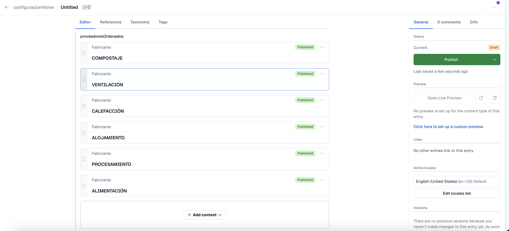
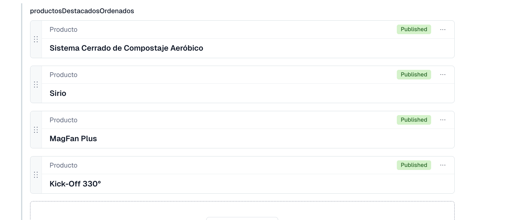

# Cómo cambiar el orden de la página de inicio

**Última revisión:** 2026-11-23.

Con esta guía podés cambiar **en qué orden aparecen los proveedores y los productos destacados** en la página de inicio de eggpertise.com, arrastrándolos, sin pedirle nada al equipo técnico.

## Antes de empezar

- Necesitás **acceso a Contentful** (la herramienta donde se carga el contenido del sitio) con permiso de edición. Si no entrás o no ves el contenido, pedíselo a Emilia.
- Tiempo: unos 5 minutos.
- **El cambio no se ve al instante:** tarda **hasta 4 horas** en aparecer en el sitio. Es normal, no hay que repetirlo.
- Si trabajás con Claude Code, podés decirle "quiero cambiar el orden de los proveedores de la home" y te guía con esta misma guía.

## Paso a paso

1. Entrá a Contentful y abrí el espacio de EggPertise.
2. Arriba, hacé clic en la pestaña **Content**.
3. En la barra de búsqueda, donde dice **Content type** y **Any**, hacé clic en **Any** y elegí **configuracionHome**.
4. Va a aparecer **una sola entrada**, llamada **Untitled**. Hacé clic en ella para abrirla. *(Es la única: no hay que crear otra.)*
5. Vas a ver dos listas:
   - **proveedoresOrdenados**: el orden de los proveedores.
   - **productosDestacadosOrdenados**: el orden de los productos destacados.

   

6. **Para mover uno:** apoyá el mouse sobre los **seis puntitos** que están a la izquierda de la tarjeta, mantené apretado el clic, arrastrá hasta el lugar que quieras y soltá. El de más arriba es el que aparece **primero** en la página.

   

7. **Para agregar uno que no está en la lista:** debajo de la lista, hacé clic en **Add content** y después en **Add existing content**. Marcá el que querés y confirmá con **Insert**.
8. **Para sacar uno de la lista:** en la tarjeta, hacé clic en los tres puntitos **⋯** de la derecha y elegí **Remove**. *(Esto no borra al proveedor ni al producto: solo lo saca de esta lista.)*
9. **Publicá:** a la derecha de la pantalla, hacé clic en el botón verde **Publish** (si ya estaba publicado, dice **Publish changes**). **Sin este paso el sitio no se entera.**

## Cómo saber que quedó bien

- A la derecha, el estado (**Status**) tiene que decir **Published**. Si dice **Changed** o **Draft**, falta publicar.
- Pasadas **hasta 4 horas**, entrá a eggpertise.com y mirá la página de inicio: el orden de las tarjetas tiene que ser el que dejaste.
- Si necesitás verlo antes, pedile a Emilia que haga un *Redeploy* del sitio.

## Qué conviene saber

- **Lo que no está en la lista igual aparece en el sitio**, pero **al final y por orden alfabético**. Si sumás un proveedor nuevo y no lo agregás a la lista, no desaparece: queda último.
- **Para esconder un proveedor o un producto**, no alcanza con sacarlo de la lista: hay que **despublicarlo** (abrirlo y usar **Unpublish**). Hacelo con cuidado: deja de verse en todo el sitio.
- **Productos destacados:** la lista define solo el **orden**. Se muestran los productos que tienen marcada la opción **principal** en su ficha. Si agregás uno sin esa marca, no va a aparecer.
- **Siempre se edita la misma entrada.** Si crearas una segunda, el sitio no sabe cuál usar.

## Si algo sale mal

| Qué pasa | Qué hacer |
|---|---|
| No veo la pestaña **Content** o no puedo editar | Pedile acceso a Emilia |
| No encuentro la entrada | Revisá el filtro: **Content type** tiene que decir **configuracionHome** |
| No puedo arrastrar | Hay que agarrar los **seis puntitos** de la izquierda de la tarjeta, no el texto |
| Publiqué y el sitio sigue igual | Esperá hasta 4 horas. Si pasó más tiempo, avisale a Emilia |
| Se ve otro orden del que dejé | Fijate que el estado diga **Published** (no **Changed**) y que no haya otra persona editando al mismo tiempo |
| Un proveedor o producto no aparece | Tiene que estar **publicado** (y, si es un producto, con **principal** marcado) |
| Me equivoqué | Volvé a arrastrar y publicá otra vez; no se pierde nada |

## Qué NO tocar

En Contentful hay una pestaña **Content model**: **no la toques**. Cambiar los nombres de lo que hay ahí puede hacer que el sitio deje de mostrar los proveedores o los productos.

---

### Para el equipo técnico

- Tipo `configuracionHome` con los campos `proveedoresOrdenados` (lista de `fabricante`) y `productosDestacadosOrdenados` (lista de `producto`). Sus ids **no se pueden renombrar** sin cambiar `lib/contentful.ts`.
- El código lee el orden en una consulta aparte por lista; si falla o no existe la entrada, ordena alfabéticamente. Ver [`../contenido.md`](../contenido.md) y [`../arquitectura.md`](../arquitectura.md).
